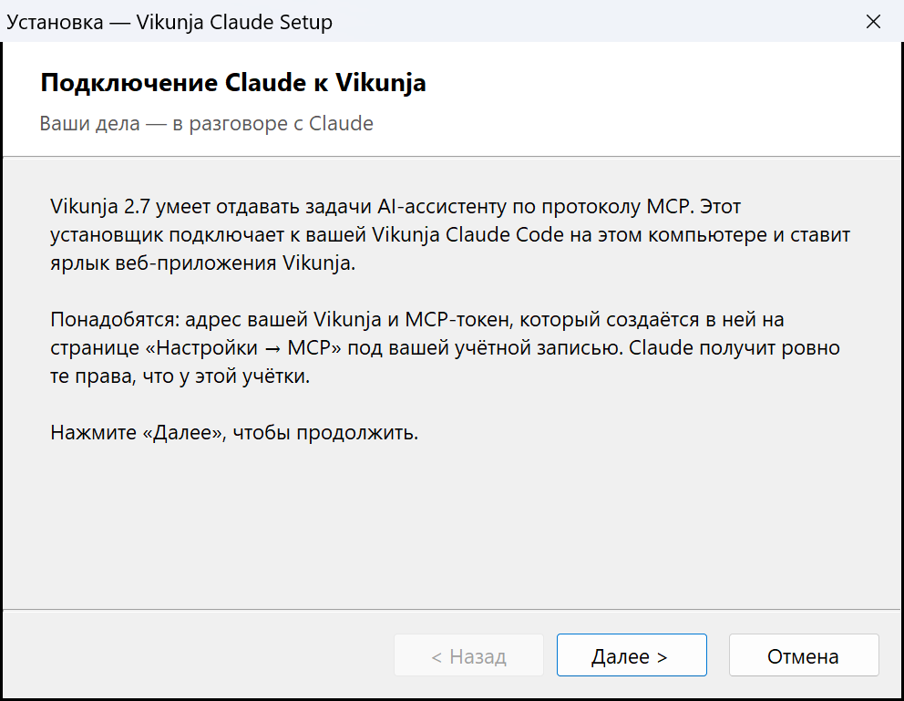
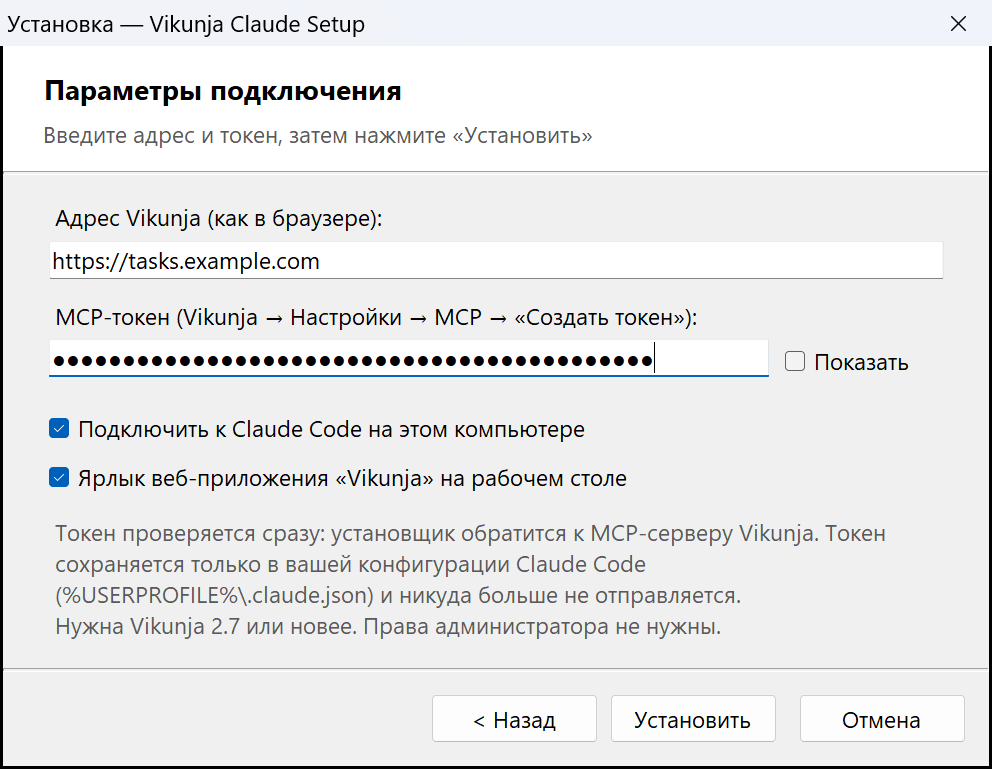

# Vikunja Claude Setup

[Русский](README.md) | **English**

A Windows installer that connects Claude to your self-hosted [Vikunja](https://vikunja.io): afterwards Claude reads and
edits your tasks, projects and labels over MCP. It also adds a Vikunja web-app shortcut.

Vikunja 2.7 ships a built-in MCP server, but wiring it to Claude means editing a JSON file by hand and copying a token
around. This installer does the same in a minute, verifies the address and the token before writing anything, and can
undo everything through the regular Windows uninstall.

<p> </p>

## What you get

| Where | What the installer does | Result |
|---|---|---|
| Vikunja | Calls the MCP endpoint `…/api/v2/mcp` with your token: `initialize`, `tools/list` | Token and address verified before any write |
| Claude Code | Writes the `vikunja` server (HTTP, `Authorization` header) into `%USERPROFILE%\.claude.json`, with a backup | Vikunja tools appear in the next Claude Code session |
| Desktop and Start menu | "Vikunja" shortcut: Chrome or Edge in app mode (a window without tabs) | The tracker opens like a program |
| Settings → Apps | A Vikunja Claude Setup entry | One-click uninstall: server entry, shortcuts, its own folder |

The token is stored only in your Claude Code configuration and is sent nowhere but your Vikunja. No administrator rights:
everything is installed for the current Windows user.

Regular Claude (web, desktop app, phone) does not read the Claude Code configuration. Add the same server once in
claude.ai settings: Connectors → Add custom connector, URL `…/api/v2/mcp`, Authentication "No sign-in", header
`Authorization` = `Bearer <token>`. The installer shows these values on its last page.

## Install

1. In Vikunja (2.7 or newer), under your own account: **Settings → MCP → Create token**. Save the token, it is shown once.
   Claude gets exactly the permissions of that account.
2. Download **[Vikunja-Claude-Setup.exe](https://github.com/gp131313/vikunja-claude-setup/releases/latest/download/Vikunja-Claude-Setup.exe)**
   and run it: Next → Vikunja address and token → Install.
3. Open a new Claude Code session: the `vikunja` server is listed under `/mcp`.

If Windows shows "Windows protected your PC", click "More info" → "Run anyway": the installer is unsigned. If you
prefer not to run an exe, the release also has `Vikunja-Claude-Setup-*.zip`: unpack it and double-click `Setup.cmd`,
which asks for the address and the token and does the same.

### Silent install

`Vikunja-Claude-Setup-Silent.exe` (or `Vikunja-Claude-Setup.exe /silent`) shows no windows:

```
Vikunja-Claude-Setup-Silent.exe /url=https://tasks.example.com /tokenfile=C:\path\token.txt [/noshortcut] [/noclaude]
```

The token comes from a file (`/tokenfile`) or from the `VIKUNJA_MCP_TOKEN` environment variable; it is never passed on
the command line. Exit codes: 0 done, 2 token rejected, 3 address unreachable, 4 no Vikunja MCP at that address, 1 other.
Silent-mode errors go to `%TEMP%\VikunjaClaudeSetup-install.log`.

## How it works

```
Vikunja 2.7+  ──POST /api/v2/mcp (Bearer tk_…)──  Claude Code (%USERPROFILE%\.claude.json → mcpServers.vikunja)
                                                   claude.ai / Claude Desktop / phone (custom connector)
```

- `windows/install.ps1` — all the logic: verification, configuration write, shortcut, uninstall registration.
- `windows/uninstall.ps1` — the reverse; it does not touch the token in Vikunja.
- `windows/setup/Setup.cs` — the WinForms wizard; both scripts are embedded in the exe. The token reaches the script
  through the process environment, not the command line.
- `windows/Setup.cmd` — the exe-free way.

## Build from source

No SDK needed, the C# compiler bundled with Windows (.NET Framework 4.x) is enough:

```
powershell -NoProfile -ExecutionPolicy Bypass -File windows\setup\build.ps1
```

Output: `windows\setup\out\Vikunja-Claude-Setup.exe` and `…-Silent.exe` (the same file; the mode is picked by file name).

## Limitations

- Windows 10/11 with Windows PowerShell 5.1 only (present in every Windows). On Linux and macOS one command does it:
  `claude mcp add --transport http vikunja https://<your vikunja>/api/v2/mcp --header "Authorization: Bearer <token>"`.
- Requires Vikunja 2.7 or newer, which introduced the built-in MCP server. Third-party MCP servers for older versions are not installed.
- If Vikunja sits behind a reverse proxy with HTTP Basic authentication, the `Authorization` header never reaches it and
  the token is rejected. Remove Basic auth for that host or expose MCP another way.
- If your claude.ai account already has a custom connector for the same address, the Claude desktop app may drop the
  local entry from `.claude.json` and use the account connector instead. That is fine: one of the two paths works.
- A Vikunja MCP token has an expiry (chosen when you create it). When it expires, run the installer again with a new token.

## Support

If this saved you time, you can buy me a coffee: Dogecoin `D7z9UaBsmcV7EqJo5Y5fdLG9xUNw47dNgr` (see [DONATE.md](DONATE.md)).

## License

[MIT](LICENSE). Vikunja is a separate AGPL-3.0 project and Claude is an Anthropic product; this installer is affiliated with neither.
